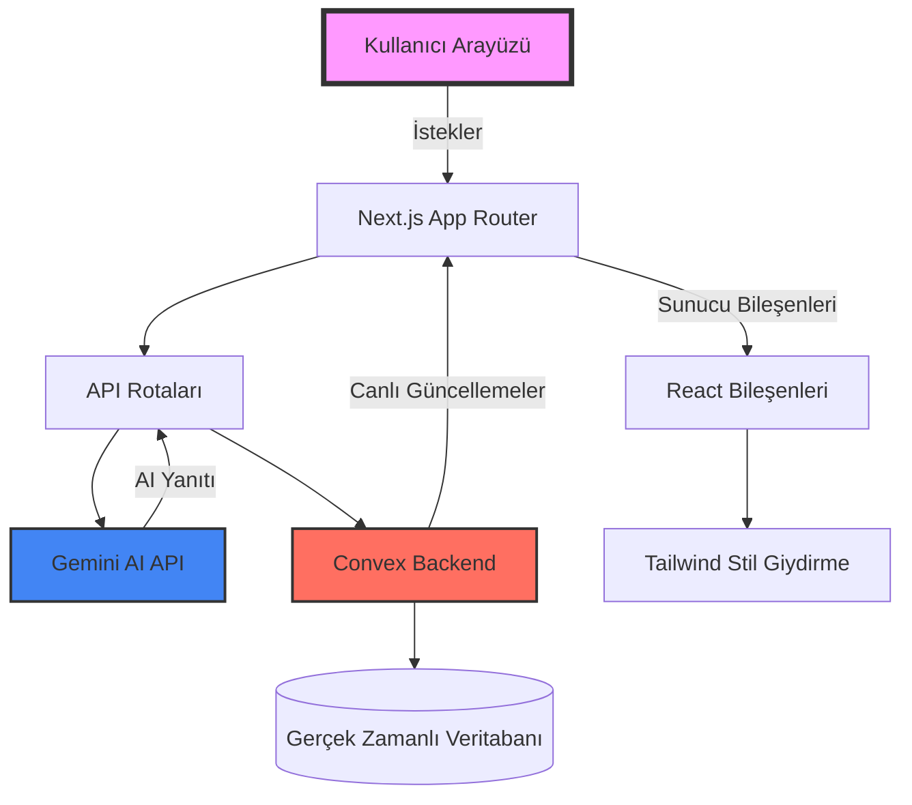

# 🚀 LuminaAI Web Builder

<p align="center"><i>Yapay Zeka Yardımıyla Harika Web Siteleri İnşa Edin</i></p>
<p align="center">En son yapay zeka teknolojisini kullanarak fikirlerinizi tamamen çalışan web sitelerine dönüştürün.</p>

<p align="center">
  <a href="https://opensource.org/licenses/MIT">
    
  </a>
  
  
</p>

<p align="center">
  
  
  
  
</p>

---

## Proje Hakkında 🌟

**LuminaAI Web Builder**, yapay zekanın gücünü (Google Gemini API) modern web teknolojileriyle birleştirerek web geliştirmede devrim yaratan son teknoloji bir platformdur. Sadece doğal dilde (Türkçe) ne istediğinizi yazarak, herhangi bir kodlama deneyimine ihtiyaç duymadan harika ve üretime hazır web uygulamaları tasarlayabilirsiniz!

### Öne Çıkan Özellikler 🚀

*   **Yapay Zeka Destekli Sihir**: Doğal dilden anında React kodları üretir.
*   **Gerçek Zamanlı Kod Önizleme**: Tarayıcıda yerleşik Sandbox (Sandpack) ile kodları canlı olarak çalıştırır ve gösterir.
*   **Dosya İndirme Sistemi**: Oluşturulan tüm React + Vite proje kodlarını tek tıkla `.zip` olarak bilgisayarınıza indirebilirsiniz.
*   **İstemi İyileştirme (Enhance Prompt)**: Yapay zekaya göndereceğiniz kısa cümleleri "Sihirli Değnek" butonu ile otomatik olarak daha detaylı istemlere dönüştürür.
*   **Mobil Uyumlu**: Tamamen responsive ve modern Tailwind CSS ile tasarlanmıştır.

---

## Proje Mimarisi 📂



### 📁 Klasör Yapısı

```bash
ai-website-builder/
│
├── 📂 app/                    # Next.js App Router Sayfaları
│   ├── 📂 api/               # API Uç Noktaları (ai-chat, gen-ai-code vb.)
│   ├── 📂 (main)/            # Workspace Sayfaları
│   └── 📄 layout.js          # Genel Sayfa Düzeni
│
├── 📂 components/            # Yeniden Kullanılabilir Bileşenler
│   ├── 📂 custom/            # Özel Bileşenler (Hero, Header, ChatView, CodeView)
│   └── 📂 ui/                # Shadcn UI Bileşenleri
│
├── 📂 configs/              # Yapay Zeka Modeli Yapılandırmaları
│   └── 📄 AiModel.jsx        # Gemini Bağlantısı
│
├── 📂 convex/              # Convex Backend Servisi (Veritabanı Şeması ve Mutasyonlar)
│   ├── 📄 schema.js          # Tablo Şemaları
│   └── 📄 workspace.js       # Sorgular
│
└── 📄 package.json           # Bağımlılıklar ve Çalıştırma Komutları
```

---

## Hızlı Başlangıç 🛠️

### 📋 Gereksinimler
*   Bilgisayarınızda **Node.js** (v18 veya üzeri) kurulu olmalıdır.
*   Bir **Google Gemini API Key** almanız gerekmektedir.
*   Bir **Convex** hesabı ve projesi oluşturulmalıdır.

### 🚀 Kurulum Adımları

1.  **Depoyu Klonlayın ve Bağımlılıkları Yükleyin**
    ```bash
    git clone https://github.com/haliltek/ai-website-builder.git
    cd ai-website-builder
    npm install
    ```

2.  **Ortam Değişkenlerini Yapılandırın**
    Projenin ana dizininde `.env.local` dosyası oluşturun ve aşağıdaki değişkenleri tanımlayın:
    ```env
    # Gemini Yapay Zeka Anahtarı
    NEXT_PUBLIC_GEMINI_API_KEY=your_gemini_api_key_here
    
    # Convex Veritabanı URL'si (npx convex dev çalıştırıldığında otomatik de üretilebilir)
    NEXT_PUBLIC_CONVEX_URL=your_convex_deployment_url
    ```

3.  **Geliştirici Sunucusunu Başlatın**
    Next.js geliştirici sunucusunu başlatmak için:
    ```bash
    npm run dev
    ```
    Yeni bir terminal açıp Convex veritabanı eşlemesini ve sunucusunu başlatmak için:
    ```bash
    npx convex dev
    ```
    Tarayıcınızdan **[http://localhost:3000](http://localhost:3000)** adresine giderek uygulamayı kullanmaya başlayabilirsiniz!

---

## Kullanım Örnekleri 💬

| İsteminiz (Prompt) | Yapay Zekanın Ürettiği Çıktı |
| :--- | :--- |
| `"Bir SaaS ürünü için kahraman (hero) alanı, özellikler tablosu ve fiyat kartları içeren modern bir landing page tasarla"` | <ul><li>Tüm React bileşenleri</li><li>Responsive Tailwind CSS tasarımı</li><li>Tıklanabilir ve etkileşimli alanlar</li><li>Tamamen Türkçe içerik</li></ul> |

---

## Teşekkürler ve Referanslar 💖
Bu projeyi geliştirmemizde katkısı olan veya ilham veren kütüphanelere teşekkür ederiz:
*   [Google Gemini API](https://ai.google.dev/) - Güçlü yapay zeka altyapısı için.
*   [Convex](https://convex.dev/) - Gerçek zamanlı ve hızlı veritabanı altyapısı için.
*   [CodeSandbox Sandpack](https://sandpack.codesandbox.io/) - Tarayıcı içi canlı React derleyicisi için.
*   [Tailwind CSS](https://tailwindcss.com/) - Harika ve hızlı tasarım imkanı sunduğu için.

---
**Mutlu Kodlamalar!** 🚀 • [Halil TEK](https://github.com/haliltek)
